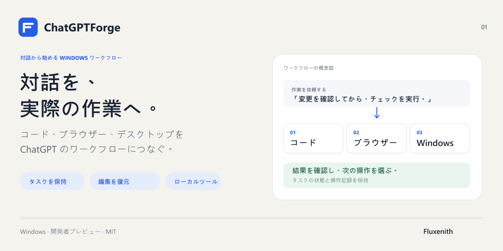
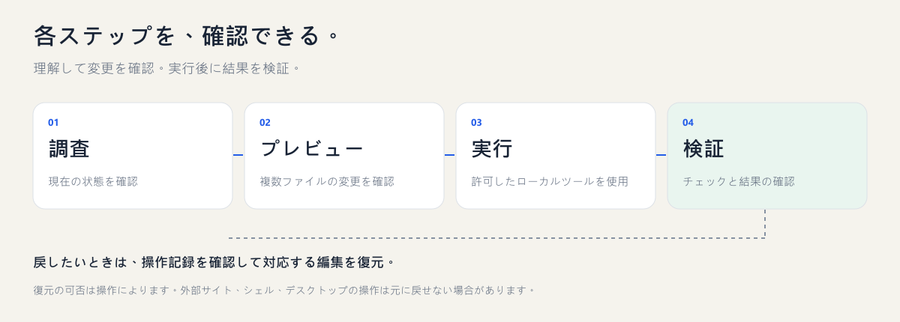

# ChatGPTForge

[English](README.md) · [繁體中文](README.zh-TW.md) · [简体中文](README.zh-CN.md) · [日本語](README.ja.md) · [한국어](README.ko.md)

**ChatGPT の対話を、Windows 上の実作業につなげる。**

プロジェクトの編集、チェックの実行、許可したブラウザーやデスクトップの操作を、タスクの状態と操作記録を残しながら進められます。

## できること

- 複数ファイルにまたがる参照や名前変更をプレビューし、対応する編集をロールバック。
- タスクの状態と操作記録を保持し、中断後に状況を確認して再開。
- 明示的に参加させたプロジェクト間でメモリを共有し、参照を更新。
- 許可したブラウザーや Windows ウィンドウを操作し、実行後の状態を確認。
- オプション構成の依存関係をチェック・修復し、複数の MCP サービスを個別に検証。

## 使い始める

正式対応プラットフォームは Windows です。Node 22.19–26.x、npm、Git、PowerShell が必要です。ChatGPT と HTTPS MCP 接続は別途設定します。ソースからインストールする開発者プレビュー版です。ドキュメントの多言語化は、macOS や Linux への対応を意味しません。

~~~powershell
git clone https://github.com/Fluxenith/ChatGPTForge.git
cd ChatGPTForge/runtime
npm ci
npm run build
node dist/forge-cli.js init --workspace C:\Projects\MyApp --public-url https://YOUR_MCP_HOST
node dist/forge-cli.js serve
~~~

先にプロジェクトフォルダーを作成し、管理権限のある HTTPS オリジンを指定してください。既存のトンネルをローカル MCP サービスへ転送するよう設定し、ChatGPT の接続画面で OAuth 認証を完了します。ローカルサービスを起動しただけでは ChatGPT には接続されません。 [MCP / OAuth](docs/connection.md)

## Forge の Chrome 拡張機能をインストール

**ChatGPTForge Continuation** は、このリポジトリに含まれる拡張機能です。ログイン済みの ChatGPT ブラウザーでタスクの引き継ぎを続行し、管理画面からプロジェクト用プラグインのフォーム入力を補助します。通常の MCP コード編集・メモリ・デスクトップ機能には不要です。HTTPS MCP / OAuth の接続設定は別途必要です。

1. Forge を起動し、ChatGPT にログイン済みの Chrome プロファイルを使用します。
2. `chrome://extensions` を開き、「デベロッパー モード」を有効にして「パッケージ化されていない拡張機能を読み込む」を選びます。
3. ダウンロードまたは clone した `runtime/browser-extension` フォルダーを選びます。`manifest.json` を含むフォルダーです。リポジトリのルートや ZIP は選ばないでください。**ChatGPTForge Continuation** が表示されます。
4. 管理画面 `http://127.0.0.1:8768` の設定から Chrome 拡張機能のペアリングを開き、ペアリングコードをコピーします。
5. 拡張機能の設定を開き、管理サービスのアドレス `http://127.0.0.1:8768`（変更した場合はその管理ポート）とペアリングコードを入力します。
6. 自動引き継ぎを有効にして設定を保存し、今すぐ確認するボタンを押します。待機中のタスクがなければ、接続済み・引き継ぎ待ちの状態になります。有効化すると、キュー内の引き継ぎプロンプトが新しい ChatGPT タブで送信されます。

利用中は Forge と Chrome を起動したままにしてください。拡張機能のファイル更新後は Chrome の拡張機能一覧で再読み込みします。ペアリングコードは公開しないでください。ChatGPT のパスワードや Playwright のトークンとは異なります。[接続とトラブルシューティング（英語）](docs/connection.md)。

### Playwright Extension も必要ですか？

既存の Chrome タブを操作する場合のみ、Microsoft の [Playwright Extension](https://chromewebstore.google.com/detail/playwright-extension/mmlmfjhmonkocbjadbfplnigmagldckm) を別途インストールし、Forge の `playwright-browser` gateway を設定して接続を許可します。拡張機能のインストールだけでは gateway は設定されません。**2 つの拡張機能は用途が異なり、常に両方が必要なわけではありません。**[設定手順（英語）](docs/connection.md#optional-existing-chrome-tab-automation)。

## 依頼から結果まで

製品画像とフロー図は概念図であり、アプリのスクリーンショットではありません。内容を理解し、変更を確認してから実行・検証します。

> このプロジェクトを調べ、修正案を説明してください。複数ファイルの変更をプレビューし、確認した修正を適用して、関連するチェックと結果を示してください。失敗した場合は、再試行する前に原因を調べてください。

復元できるのは記録された対応操作のみです。外部サイト、シェル、デスクトップでのすべての操作を取り消せるわけではありません。結果が不明な場合は、次の書き込み前に操作記録を確認してください。

## オプション構成

~~~powershell
node dist/forge-cli.js deployment check --manifest examples/deployment-profile.json
node dist/forge-cli.js deployment repair --manifest examples/deployment-profile.json
~~~

チェックだけではソフトウェアはインストールされません。修復・デプロイには --apply、ダウンロードには追加で --online が必要です。新しい外部ツールは、許可するまで操作できません。

## ドキュメント

以下の技術文書は原文のままです。

- [Deployment](runtime/docs/deployment.md)
- [Shared memory](runtime/docs/global-memory.md)
- [Windows desktop](runtime/docs/desktop-surface.md)
- [Operating guide](runtime/skills/forge-operation/SKILL.md)
- [Contributing](CONTRIBUTING.md) / [Security](SECURITY.md)

## 導入・連携のご相談

[導入・連携について問い合わせる](https://github.com/Fluxenith/ChatGPTForge/issues/new?template=setup-request.yml)

実現したいワークフローをお知らせください。有償の導入支援やカスタム連携への関心も記載できます。対応可否、範囲、料金は別途相談となり、このフォームで購入や決済は行われません。公開 issue に個人情報、認証情報、非公開コードを記載しないでください。

Fluxenith がメンテナンスしています。MIT ライセンス。第三者のライセンス表記を保持しています。本プロジェクトは独立しており、OpenAI との提携・承認関係はありません。 [LICENSE](LICENSE) · [Fluxenith](https://github.com/Fluxenith)
