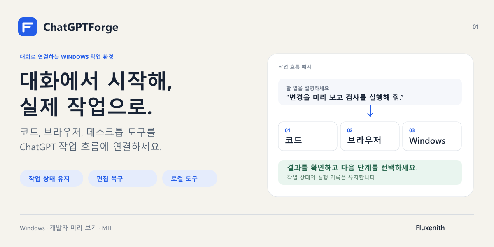
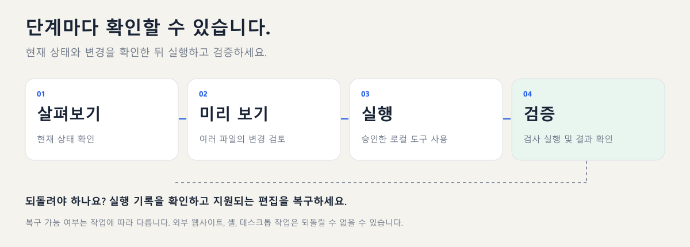

# ChatGPTForge

[English](README.md) · [繁體中文](README.zh-TW.md) · [简体中文](README.zh-CN.md) · [日本語](README.ja.md) · [한국어](README.ko.md)

**ChatGPT 대화를 Windows에서의 실제 작업으로 연결하세요.**

프로젝트를 수정하고 검사를 실행하며, 승인한 브라우저와 데스크톱 창을 조작할 수 있습니다. 작업 상태와 실행 기록을 남기고, 지원되는 코드 변경은 되돌릴 수 있습니다.

## 주요 기능

- 여러 파일의 참조와 이름 변경을 미리 보고, 지원되는 편집을 롤백합니다.
- 작업 상태와 실행 기록을 유지해 중단된 작업의 결과를 확인하고 이어갑니다.
- 명시적으로 참여시킨 프로젝트끼리 메모리를 공유하고 참조를 갱신합니다.
- 승인한 브라우저와 Windows 창을 조작한 뒤 결과를 다시 확인합니다.
- 선택 구성 요소의 의존성을 점검·복구하고 여러 MCP 서비스를 개별 검증합니다.

## 시작하기

공식 지원 플랫폼은 Windows입니다. Node 22.19–26.x, npm, Git, PowerShell이 필요하며 ChatGPT 및 HTTPS MCP 연결은 별도로 설정해야 합니다. 소스에서 설치하는 개발자 미리 보기 버전입니다. 다국어 문서는 macOS 또는 Linux 지원을 의미하지 않습니다.

~~~powershell
git clone https://github.com/Fluxenith/ChatGPTForge.git
cd ChatGPTForge/runtime
npm ci
npm run build
node dist/forge-cli.js init --workspace C:\Projects\MyApp --public-url https://YOUR_MCP_HOST
node dist/forge-cli.js serve
~~~

프로젝트 폴더를 먼저 만들고 직접 관리하는 HTTPS 주소를 지정하세요. 기존 터널이 로컬 MCP 서비스로 연결되도록 설정한 다음 ChatGPT 연결 화면에서 OAuth 인증을 완료하세요. 로컬 서비스 실행만으로 ChatGPT 연결이 완료되지는 않습니다. [MCP / OAuth](docs/connection.md)

## Forge Chrome 확장 프로그램 설치

**ChatGPTForge Continuation**은 이 저장소에 포함된 확장 프로그램입니다. 로그인된 ChatGPT 브라우저에서 작업 인계를 이어가고, 관리 페이지의 프로젝트 플러그인 양식 입력을 돕습니다. 일반 MCP 코드 편집·메모리·데스크톱 기능에는 필요하지 않습니다. HTTPS MCP / OAuth 연결은 별도로 설정해야 합니다.

1. Forge를 실행하고 ChatGPT에 로그인한 Chrome 프로필을 사용하세요.
2. `chrome://extensions`에서 ‘개발자 모드’를 켜고 ‘압축해제된 확장 프로그램을 로드합니다’를 선택하세요.
3. 다운로드하거나 clone한 `runtime/browser-extension` 폴더를 선택하세요. `manifest.json`이 있는 폴더이며, 저장소 최상위 폴더나 ZIP 파일이 아닙니다. **ChatGPTForge Continuation**이 표시되어야 합니다.
4. 로컬 관리 페이지 `http://127.0.0.1:8768`의 설정에서 Chrome 확장 프로그램 페어링을 열고 페어링 코드를 복사하세요.
5. 확장 프로그램 설정에서 관리 서비스 주소 `http://127.0.0.1:8768`(변경했다면 해당 관리 포트)를 입력하고 페어링 코드를 붙여 넣으세요.
6. 자동 이어가기를 켜고 설정을 저장한 뒤 즉시 확인 버튼을 누르세요. 대기 작업이 없으면 연결됨·인계 대기 상태가 표시됩니다. 활성화하면 대기 중인 인계 프롬프트가 새 ChatGPT 탭에서 전송됩니다.

사용 중에는 Forge와 Chrome을 실행해 두세요. 확장 프로그램 파일을 업데이트한 후 Chrome 확장 프로그램 목록에서 새로고침하세요. 페어링 코드는 공개하지 마세요. ChatGPT 비밀번호나 Playwright 토큰이 아닙니다. [연결 및 문제 해결(영어)](docs/connection.md).

### Playwright Extension도 필요한가요?

기존 Chrome 탭을 조작할 때만 Microsoft의 [Playwright Extension](https://chromewebstore.google.com/detail/playwright-extension/mmlmfjhmonkocbjadbfplnigmagldckm)을 별도로 설치하고 Forge의 `playwright-browser` gateway를 설정한 뒤 연결을 허용해야 합니다. 확장 프로그램만 설치하면 gateway는 설정되지 않습니다. **두 확장 프로그램은 용도가 다르며 항상 둘 다 필요한 것은 아닙니다.** [설정 단계(영어)](docs/connection.md#optional-existing-chrome-tab-automation).

## 요청에서 결과까지

제품 이미지와 흐름도는 설명용 도식이며 실제 앱 화면이 아닙니다. 현재 상태와 변경 내용을 확인한 뒤 실행하고 결과를 검증합니다.

> 이 프로젝트를 살펴보고 수정안을 설명해 주세요. 여러 파일의 변경을 미리 보여 주고, 확인된 수정을 적용한 다음 관련 검사를 실행해 결과를 알려 주세요. 검사에 실패하면 재시도하기 전에 원인을 조사해 주세요.

복구는 기록이 남아 있는 지원 작업에만 적용됩니다. 외부 웹사이트, 셸, 데스크톱에서 수행한 모든 작업을 취소할 수 있는 것은 아닙니다. 결과가 불분명하면 다음 쓰기 작업 전에 실행 기록을 확인하세요.

## 선택 구성 요소

~~~powershell
node dist/forge-cli.js deployment check --manifest examples/deployment-profile.json
node dist/forge-cli.js deployment repair --manifest examples/deployment-profile.json
~~~

점검만으로 소프트웨어가 설치되지는 않습니다. 복구와 배포에는 --apply가 필요하며 다운로드에는 --online도 필요합니다. 새 외부 도구는 승인하기 전까지 조작할 수 없습니다.

## 문서

아래 기술 문서는 원문으로 제공됩니다.

- [Deployment](runtime/docs/deployment.md)
- [Shared memory](runtime/docs/global-memory.md)
- [Windows desktop](runtime/docs/desktop-surface.md)
- [Operating guide](runtime/skills/forge-operation/SKILL.md)
- [Contributing](CONTRIBUTING.md) / [Security](SECURITY.md)

## 설치 및 연동 문의

[설치 및 연동 문의하기](https://github.com/Fluxenith/ChatGPTForge/issues/new?template=setup-request.yml)

원하는 작업 흐름을 알려 주세요. 유료 초기 설정이나 맞춤 연동에 대한 관심도 표시할 수 있습니다. 제공 가능 여부, 범위, 비용은 별도로 협의하며 이 양식은 구매·결제 페이지가 아닙니다. 공개 이슈에 개인정보, 인증 정보, 비공개 코드를 올리지 마세요.

Fluxenith가 관리합니다. MIT 라이선스이며 제3자 라이선스 고지를 유지합니다. 독립 프로젝트로, OpenAI와 제휴 관계가 없으며 OpenAI의 보증을 받지 않습니다. [LICENSE](LICENSE) · [Fluxenith](https://github.com/Fluxenith)
