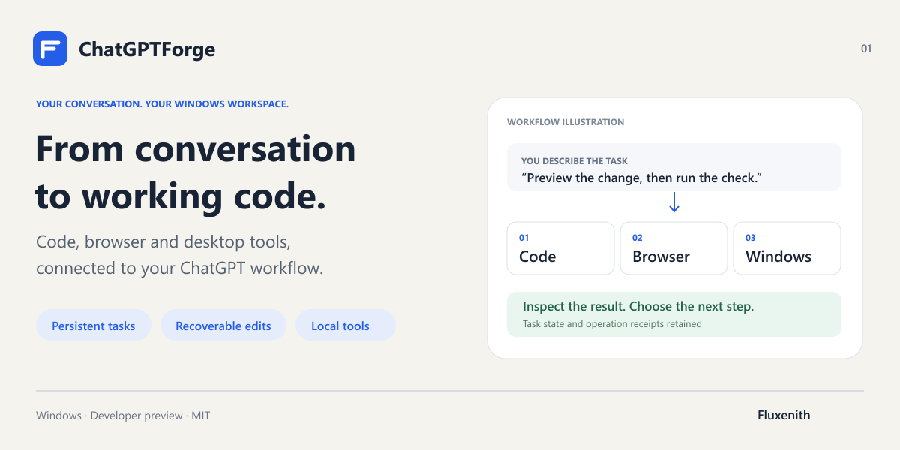
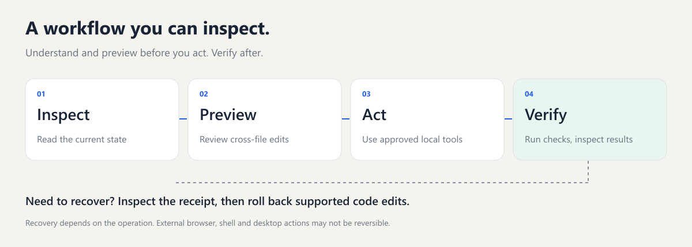

# ChatGPTForge

[English](README.md) · [繁體中文](README.zh-TW.md) · [简体中文](README.zh-CN.md) · [日本語](README.ja.md) · [한국어](README.ko.md)

**Turn a ChatGPT conversation into work on your Windows machine.**

Edit a project, run its checks, automate an approved browser, and inspect the result—with persistent tasks and recoverable code changes.

[Get started](#get-started) · [Deployment guide](runtime/docs/deployment.md) · [繁體中文](README.zh-TW.md) · [Setup & integration inquiries](https://github.com/Fluxenith/ChatGPTForge/issues/new?template=setup-request.yml)

## What you can do

| Your task | How Forge helps |
|---|---|
| Fix code across files | Preview semantic references and renames, apply the changes, run checks, and roll back supported edits. |
| Pick up interrupted work | Persistent task state and operation receipts help you inspect what ran before continuing. |
| Reuse project knowledge | Explicitly share memories across projects, propagate reference renames, and recover changes. |
| Work in a browser | Connect browser tools for approved navigation, interaction and inspection. Existing Chrome tab automation uses the separate Playwright Extension setup below. |
| Operate Windows apps | Observe supported windows, locate desktop surfaces, click and drag between approved windows, then inspect the result. |
| Add optional tools | Check dependencies, repair supported missing prerequisites, and verify mixed stdio/HTTP services independently. |

Forge executes local tools. Reasoning stays in your ChatGPT conversation; Forge does not run an additional model service.

## Get started

You need Windows, Node **22.19–26.x**, npm, Git and PowerShell. ChatGPT access and an authenticated HTTPS MCP connection are configured separately. This is a developer preview, with source installation rather than a one-click consumer installer.

~~~powershell
git clone https://github.com/Fluxenith/ChatGPTForge.git
cd ChatGPTForge/runtime
npm ci
npm run build
node dist/forge-cli.js init --workspace C:\Projects\MyApp --public-url https://YOUR_MCP_HOST
node dist/forge-cli.js serve
~~~

Create the workspace first. Use an HTTPS origin you control and configure your existing tunnel to the local MCP listener. Complete OAuth in the ChatGPT connection UI. Local startup alone does not connect ChatGPT. See [connection setup](docs/connection.md).

## Install the Forge Chrome extension

**ChatGPTForge Continuation** is the extension included in this repository. Install it to continue queued handoffs in your signed-in ChatGPT browser or use the Manager's project-plugin form helper. Ordinary MCP code, memory and desktop tools do not require it. It does not replace the HTTPS MCP / OAuth connection above.

1. Start Forge, then use the Chrome profile where you are signed in to ChatGPT.
2. Open `chrome://extensions`, enable **Developer mode**, and choose **Load unpacked**.
3. Select the cloned repository's `runtime/browser-extension` folder—the folder containing `manifest.json`, not the repository root or a ZIP file. Chrome should show **ChatGPTForge Continuation**.
4. Open the local Manager at `http://127.0.0.1:8768`. Under **Settings → Chrome extension pairing**, click **Copy Chrome pairing code**.
5. Open the extension's options. Set the local Manager address to `http://127.0.0.1:8768` (or your configured Manager port) and paste the pairing code.
6. Enable **automatic continuation**, click **Save settings**, then **Check now**. A successful connection with no queued task shows **Connected, waiting for handoff**. Enabling it allows queued handoff prompts to be submitted in a new ChatGPT tab.

Keep Forge running and Chrome open. After updating the extension files, click **Reload** on its Chrome extensions card. Keep the pairing code private; it is not your ChatGPT password or a Playwright token. [Troubleshooting and connection details](docs/connection.md).

### Do I also need Playwright Extension?

Only for the separate **existing Chrome tab automation** route: install Microsoft's [Playwright Extension](https://chromewebstore.google.com/detail/playwright-extension/mmlmfjhmonkocbjadbfplnigmagldckm), configure Forge's `playwright-browser` gateway, and allow the connection when prompted. Installing the extension alone does not configure that gateway. **Forge Continuation and Playwright Extension serve different purposes; you do not need both for every workflow.** [Setup steps](docs/connection.md#optional-existing-chrome-tab-automation).

## From request to result

The diagrams above illustrate the workflow; they are not application screenshots.

## Try a small workflow

After connecting Forge, start with a disposable project:

> Inspect this project and explain the proposed fix. Preview any cross-file changes, apply the agreed fix, run the relevant check, and show the result. If the check fails, inspect the failure before retrying.

Use the live tool schemas for arguments. Review unknown operation outcomes before sending another write. Recoverable edits cover supported journaled operations; they do not undo every external browser, shell or desktop action.

## Optional components

~~~powershell
node dist/forge-cli.js deployment check --manifest examples/deployment-profile.json
node dist/forge-cli.js deployment repair --manifest examples/deployment-profile.json
~~~

Checks do not install software. Repair and deployment require explicit apply flags; downloads also require the online flag. New external tools remain unapproved until configured. Follow the [deployment guide](runtime/docs/deployment.md) for exact steps.

## Learn more

- [Shared project memory](runtime/docs/global-memory.md)
- [Windows desktop operations](runtime/docs/desktop-surface.md)
- [Operating guide](runtime/skills/forge-operation/SKILL.md)
- [Contributing](CONTRIBUTING.md) and [security](SECURITY.md)

## Need help setting it up?

[Open a setup or integration inquiry](https://github.com/Fluxenith/ChatGPTForge/issues/new?template=setup-request.yml) with your intended workflow. You can indicate interest in paid onboarding or custom integration; availability, scope and pricing are agreed separately. Please keep private information out of public issues.

If Forge helps you, star the repository and share the workflow you built. Maintained by [Fluxenith](https://github.com/Fluxenith).

## License

MIT. See [LICENSE](LICENSE) and bundled third-party notices. ChatGPTForge is an independent project and is not affiliated with or endorsed by OpenAI.
