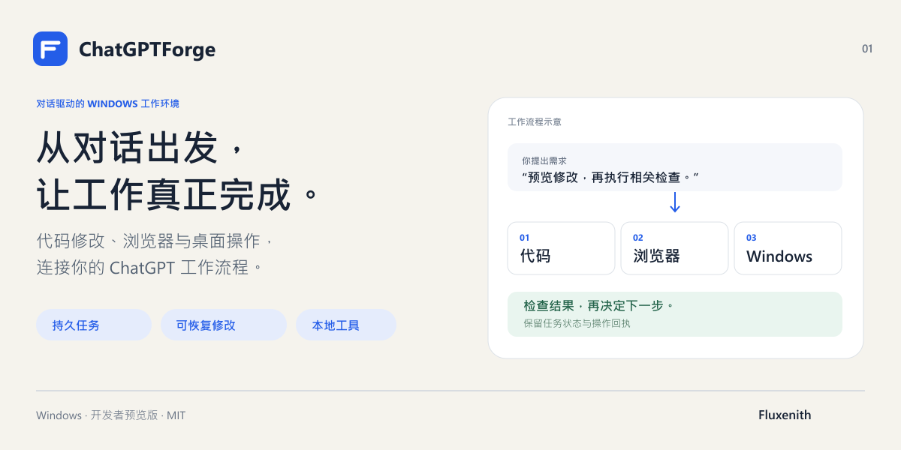
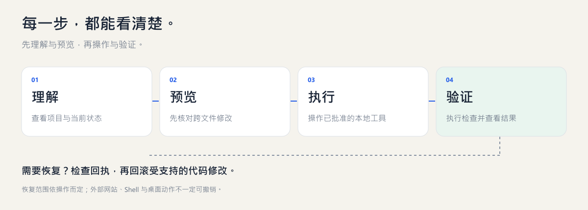

# ChatGPTForge

[English](README.md) · [繁體中文](README.zh-TW.md) · [简体中文](README.zh-CN.md) · [日本語](README.ja.md) · [한국어](README.ko.md)

**让 ChatGPT 对话连接你的 Windows 开发环境。**

修改项目、执行检查、操作已授权的浏览器与桌面窗口，并保留任务记录及受支持修改的恢复能力。

## 主要功能

- 跨文件引用预览、语义重命名与受支持操作的回滚。
- 持久任务状态、操作回执与验证记录，帮助继续中断的工作。
- 明确加入的跨项目共享记忆与引用更新。
- 已授权的浏览器及 Windows 桌面操作，操作后重新观察。
- 可选组件依赖检查、修复流程与混合 MCP 服务部署。

## 开始使用

目前正式支持的平台是 Windows。需要 Node 22.19–26.x、npm、Git、PowerShell，以及另外配置的 ChatGPT／HTTPS MCP 连接。这是通过源码安装的开发者预览版；多语言文档不代表支持 macOS 或 Linux。

~~~powershell
git clone https://github.com/Fluxenith/ChatGPTForge.git
cd ChatGPTForge/runtime
npm ci
npm run build
node dist/forge-cli.js init --workspace C:\Projects\MyApp --public-url https://YOUR_MCP_HOST
node dist/forge-cli.js serve
~~~

请先创建项目文件夹，并使用你控制的 HTTPS 域名。将现有隧道配置为转发到本地 MCP 服务，再在 ChatGPT 连接界面完成 OAuth。仅启动本地服务并不等于已经连接 ChatGPT。 [MCP / OAuth](docs/connection.md)

## 从需求到结果

产品图和流程图是示意图，不是应用截图。先理解和预览，再操作与验证。

> 查看这个项目，解释建议的修改。先预览跨文件变更，再应用确认后的修改，执行相关检查并展示结果。若检查失败，先调查原因再重试。

恢复能力只适用于受支持且有记录的操作，不能撤销所有外部网站、Shell 或桌面动作。操作结果不明确时，请先检查回执。

## 可选组件

~~~powershell
node dist/forge-cli.js deployment check --manifest examples/deployment-profile.json
node dist/forge-cli.js deployment repair --manifest examples/deployment-profile.json
~~~

检查不会安装软件。修复和部署需明确使用 --apply，下载还需 --online。新接入工具在获得批准前不会开放操作权限。

## 文档

以下技术文档保留原文：

- [Deployment](runtime/docs/deployment.md)
- [Shared memory](runtime/docs/global-memory.md)
- [PHP](runtime/docs/php-semantic-editing.md)
- [Windows desktop](runtime/docs/desktop-surface.md)
- [Operating guide](runtime/skills/forge-operation/SKILL.md)
- [Contributing](CONTRIBUTING.md) / [Security](SECURITY.md)

## 安装与集成需求

[提交需求咨询](https://github.com/Fluxenith/ChatGPTForge/issues/new?template=setup-request.yml)

描述你想完成的工作流程，也可表达对付费安装或定制集成的兴趣。服务时间、范围和价格另行确认；这不是购买或付款页面。请勿在公开 issue 中提交个人信息、凭据或私有代码。

由 Fluxenith 维护。MIT 许可证，保留第三方许可声明。本项目独立运营，与 OpenAI 无隶属或背书关系。 [LICENSE](LICENSE) · [Fluxenith](https://github.com/Fluxenith)
