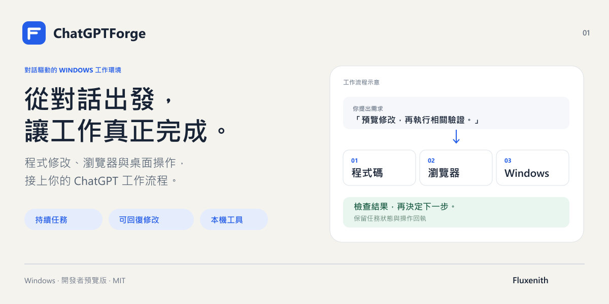
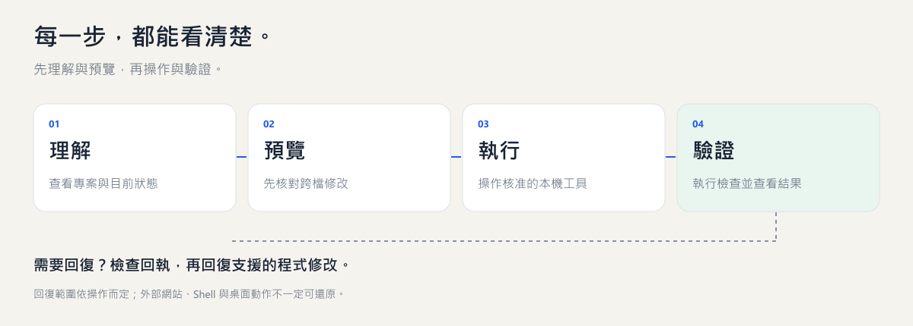
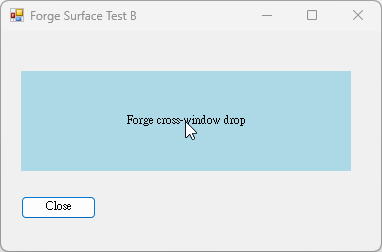

# ChatGPTForge

**讓 ChatGPT 對話直接連接你的 Windows 開發環境。**

修改專案、執行驗證、操作已授權瀏覽器與桌面視窗，並保留任務紀錄及支援修改的回復能力。

[English](README.md) · [安裝方式](README.md#get-started) · [部署指南](runtime/docs/deployment.md)

## 主要功能

- 跨檔引用預覽、語意改名與支援操作的回復。
- 可持續接續的任務狀態、操作回執與驗收紀錄。
- 明確加入的跨專案共享記憶與引用更新。
- 已授權瀏覽器及 Windows 桌面操作，操作後重新觀察。
- 選配依賴檢查、修復流程與混合 MCP 元件部署。

需要 Windows、Node 22.19–26.x、npm、Git、PowerShell，以及另外設定的 ChatGPT／HTTPS MCP 連線。目前提供原始碼安裝，屬開發者預覽版。帳號登入、桌面授權與第三方工具核准需各自設定。

## 從需求到結果

先查看目前狀態，再預覽修改；完成操作後核對結果。需要回復時，從回執確認支援的還原方式。

### 桌面操作範例

以下是真實執行兩個示範視窗之間文字拖放後，目的視窗收到內容的畫面。這個範例不代表所有應用與拖放格式都已驗證。

## 安裝與整合需求

[提出需求詢問](https://github.com/Fluxenith/ChatGPTForge/issues/new?template=setup-request.yml)，說明想完成的工作流程；可表達付費安裝或客製整合意願。價格、範圍與可承接時間另行確認，並非已完成付款的服務。公開 issue 請勿填入個資、憑證或私人程式碼。

由 [Fluxenith](https://github.com/Fluxenith) 維護。MIT 授權；本專案與 OpenAI 無隸屬或背書關係。
